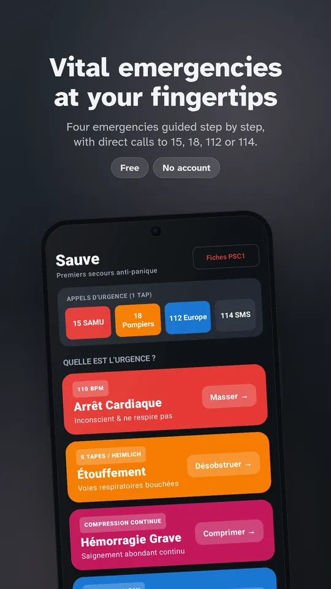
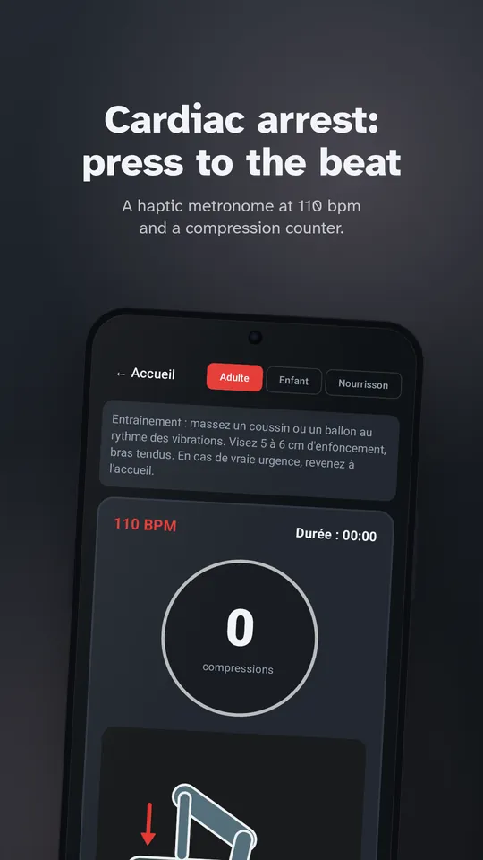
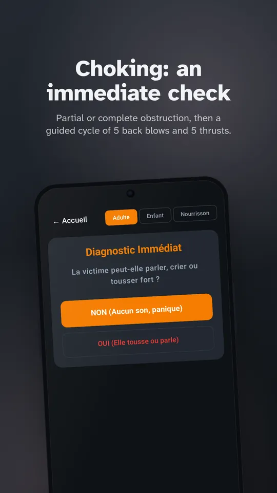
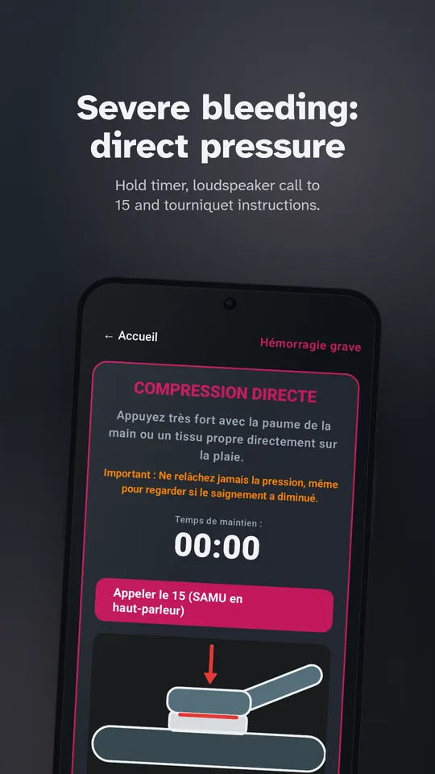
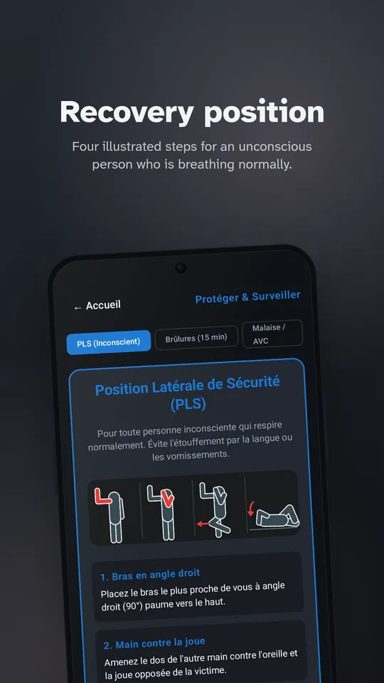
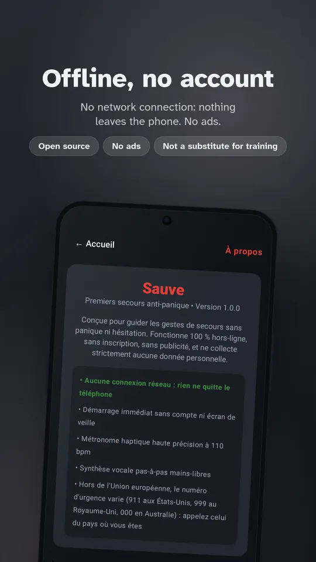

# Sauve

[Français](README.md) · **English**

An **anti-panic first aid** Android application, 100% offline, free, ad-free, with no account, no tracking and zero internet permission. Part of the **Pilmil Studio** public interest suite (along with *Lunaison*, *Sommelle* and *Respire*).

In an emergency, adrenaline and panic induce tunnel vision and motor impairment. **Sauve** is designed to open in under 300 ms, skip all non-essential menus, and provide step-by-step hands-free voice and haptic feedback.

**[Sauve website](https://relthdrarxash.github.io/sauve/)** · **[Google Play](https://play.google.com/store/apps/details?id=fr.sauve.app)** · **[Download APK](https://github.com/Relthdrarxash/sauve/releases/latest)**

---

## Screenshots

     

---

## The 4 Vital Emergencies

| Emergency | What the app does | Medical guidelines |
|---|---|---|
| **Cardiac Arrest** | Rapid consciousness & breathing check, direct emergency call (15 / 112), **haptic metronome at 110 bpm** in pocket, spoken compression count (continuous or 30:2), 2-minute rescuer relay alarm, AED guide. | ERC 2021 / PSC1 |
| **Choking (Airway Obstruction)** | Partial vs complete obstruction detection, guided **5 back blows / 5 abdominal thrusts (Heimlich)** cycle, Mofenson infant variation, instant 1-tap transition if victim loses consciousness. | PSC1 / ERC |
| **Severe Bleeding** | **Continuous manual direct pressure** instructions, duration timer, hands-free speakerphone emergency call, foreign body advice, tourniquet guidance with time logger. | PSC1 |
| **Recovery (PLS) & Burns** | Step-by-step **Recovery Position (PLS)** for unconscious breathing victims, **15-minute cooling water timer** (15-15-15 rule), FAST stroke recognition test. | PSC1 / Burns guidelines |

---

## Ethical & Technical Commitments

- **Zero INTERNET permission:** No network access declared in the Android manifest (`AndroidManifest.xml`). Operates in basements, flight mode or complete blackout; data never leaves your device.
- **Instant launch (< 300 ms):** No loading splash, no onboarding wall, no account required.
- **Hands-free guidance:** Native local Android `TextToSpeech` and precision vibration `Vibrator` keep your hands free for compressions and wound pressure.
- **1-tap emergency dial:** Direct dialer shortcuts for 15 (SAMU), 18 (Fire/Rescue), 112 (Europe) and 114 (Emergency SMS).

---

## The Pilmil Studio Suite

- **[Respire](https://github.com/Relthdrarxash/respire):** Screen-time pauses & calm disconnection without tracking
- **[Lunaison](https://github.com/Relthdrarxash/lunaison):** Intimate menstrual cycle tracker 100% offline
- **[Sommelle](https://github.com/Relthdrarxash/sommelle):** Sleep log & consistency without ads or account
- **[Sauve](https://github.com/Relthdrarxash/sauve):** Anti-panic first aid 100% offline

## License

Distributed under the [Mozilla Public License 2.0](LICENSE) (MPL-2.0): you can use, study, modify and redistribute it; files you modify must stay under the same license, with their source code.
