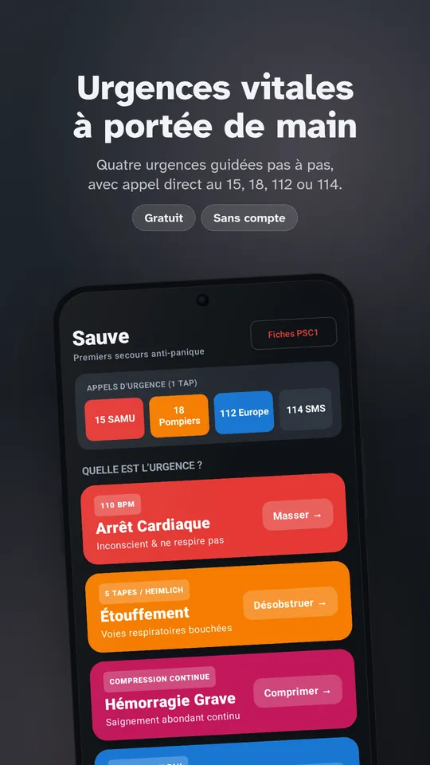
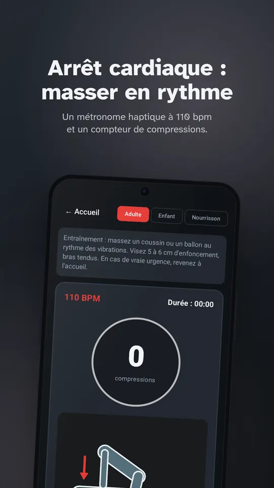
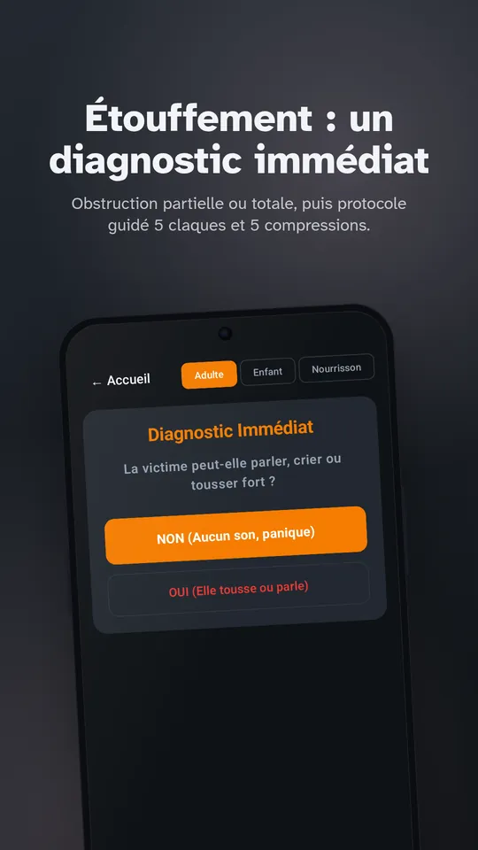
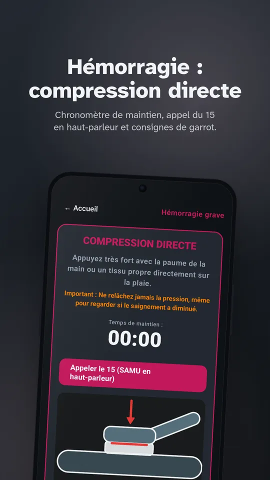
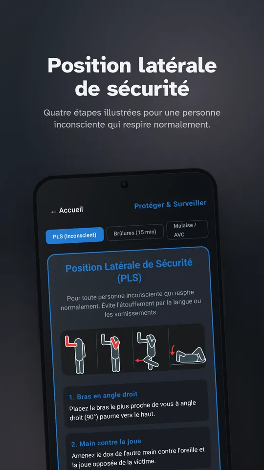
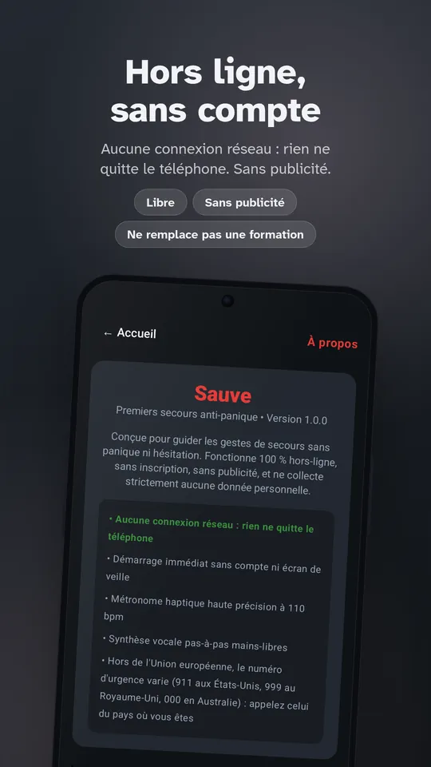

# Sauve

**Français** · [English](README.en.md)

Application Android de **premiers secours « Anti-Panique »**, 100 % hors-ligne, gratuite, sans publicité, sans inscription et sans aucune collecte de données. Fait partie de la suite d'applications de biens communs **Pilmil Studio** (avec *Lunaison*, *Sommelle* et *Respire*).

Sous l'effet du stress et de l'adrénaline, la mémoire flanche et la vue se rétrécit en tunnel. **Sauve** est pensée pour aller droit au but en moins de 300 ms, sans menu complexe, avec un guidage vocal et haptique mains-libres.

**[Site officiel Sauve](https://relthdrarxash.github.io/sauve/)** · **[Google Play](https://play.google.com/store/apps/details?id=fr.sauve.app)** · **[Télécharger l'APK](https://github.com/Relthdrarxash/sauve/releases/latest)**

---

## Captures d'écran

     

---

## Les 4 Urgences Vitales

| Urgence | Ce que fait l'application | Référentiel médical |
|---|---|---|
| **Arrêt Cardiaque** | Diagnostic express conscience/respiration, appel direct SAMU 15 / 112, **métronome haptique à 110 bpm** dans la poche, guidage vocal du compte des compressions (continu ou 30:2), alerte de relais toutes les 2 minutes, guide DAE. | ERC 2021 / PSC1 |
| **Étouffement Aigu** | Détection immédiate obstruction partielle vs totale, boucle guidée **5 claques dans le dos / 5 compressions abdominales (Heimlich)**, variante Mofenson pour nourrisson, bascule d'urgence en 1 tap en cas de perte de connaissance. | PSC1 / ERC |
| **Hémorragie Grave** | Consignes de **compression manuelle directe continue**, chronomètre de maintien, alerte haut-parleur SAMU, gestion des corps étrangers et pose de garrot avec enregistrement de l'heure. | PSC1 |
| **Inconscient (PLS) & Brûlures** | Guidage pas-à-pas de la **Position Latérale de Sécurité** pour personne inconsciente qui respire, **minuteur de 15 minutes** pour le refroidissement sous l'eau (règle des 15-15-15), test FAST pour AVC. | PSC1 / Recommandations Brûlures |

---

## Engagements éthiques & techniques

- **Zéro permission INTERNET :** Aucune autorisation réseau n'est demandée dans le manifeste Android (`AndroidManifest.xml`). L'application fonctionne sans réseau, au fond d'une cave ou en zone blanche, et aucune donnée ne sort de votre téléphone.
- **Démarrage instantané (< 300 ms) :** Aucun écran de chargement, aucun tutoriel bloquant, aucun compte à créer.
- **Mains-libres :** Synthèse vocale Android locale (`TextToSpeech`) et vibrations cadencées (`Vibrator`) pour vous permettre d'avoir les deux mains occupées à masser ou comprimer.
- **Appel d'urgence en 1 tap :** Raccourcis directs vers le 15 (SAMU), le 18 (Pompiers), le 112 (Numéro européen) et le 114 (SMS).
- **Gratuité inconditionnelle :** Aucun achat intégré, aucun abonnement, aucune fonctionnalité restreinte.

---

## Installation

- **Google Play :** [Fiche de Sauve](https://play.google.com/store/apps/details?id=fr.sauve.app)
- **APK direct :** Téléchargez la dernière version signée sur la page [Releases](https://github.com/Relthdrarxash/sauve/releases/latest).

---

## La suite Pilmil Studio

- **[Respire](https://github.com/Relthdrarxash/respire) :** Déconnexion sereine & micro-pauses sans tracking
- **[Lunaison](https://github.com/Relthdrarxash/lunaison) :** Suivi intime du cycle menstruel 100 % hors-ligne
- **[Sommelle](https://github.com/Relthdrarxash/sommelle) :** Journal et régularité du sommeil sans pub ni compte
- **[Sauve](https://github.com/Relthdrarxash/sauve) :** Premiers secours anti-panique 100 % hors-ligne

## Licence

Distribuée sous licence [Mozilla Public License 2.0](LICENSE) (MPL-2.0) : vous pouvez l'utiliser, l'étudier, la modifier et la redistribuer ; les fichiers que vous modifiez doivent rester publiés sous la même licence, avec leur code source.
